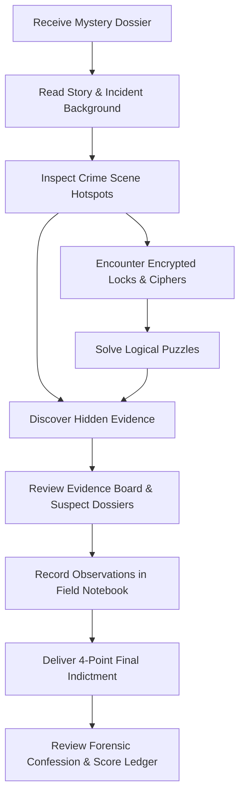

# THE LAST CLUE — Mystery Puzzle Adventure

[](https://react.dev/)
[](https://www.typescriptlang.org/)
[](https://vitejs.dev/)
[](https://tailwindcss.com/)
[]()
[]()

> *"Every crime scene tells a story. Find the last clue."*

**THE LAST CLUE** is a mystery-solving puzzle adventure game built with React 19, TypeScript, and Tailwind CSS. Players assume the role of a consulting detective summoned to investigate high-profile incidents, inspect interactive crime scenes for physical and forensic evidence, solve encrypted ciphers and logical mechanisms, cross-examine suspect alibis, and deliver formal indictments before the magistrate.

---

## Table of Contents

- [Core Gameplay Loop](#core-gameplay-loop)
- [Key Features](#key-features)
- [Case Files Catalog (8 Original Mysteries)](#case-files-catalog-8-original-mysteries)
- [Detective Progression & Scoring](#detective-progression--scoring)
- [Puzzles & Cipher Mechanics](#puzzles--cipher-mechanics)
- [Acoustic Sound Synthesizer](#acoustic-sound-synthesizer)
- [Themes & Visual Design](#themes--visual-design)
- [Project Architecture](#project-architecture)
- [Getting Started](#getting-started)
- [Configuration & Data Storage](#configuration--data-storage)
- [License](#license)

---

## Core Gameplay Loop



1. **Case Briefing**: Review the circumstances, incident time, location, and initial findings.
2. **Crime Scene Investigation**: Explore scene photographs and inspect interactive objects to extract evidence.
3. **Cipher Decryption**: Break security mechanisms, safe combinations, and anagrams to unlock restricted evidence.
4. **Suspect Interrogation**: Scrutinize suspect profiles, comparing motives, alibis, and interrogation statements against physical findings.
5. **Field Notes**: Record hypotheses, contradictions, and timestamps in an auto-saving detective notebook.
6. **Final Indictment**: Identify the **Prime Suspect**, **Motive**, **Method**, and **Key Smoking Gun Evidence**.
7. **Verdict & Confession**: Receive a score breakdown and read the full narrative confession explaining how all clues connect.

---

## Key Features

- **8 Full Original Mystery Cases**: From museum jewelry heists and Victorian poisonings to quantum server sabotage and impossible locked rooms.
- **Interactive Crime Scene Hotspots**: Clickable investigative markers on scene photography with discovery feedback and lock status.
- **Diverse Puzzle Engine**: Caesar shifts, Fibonacci series, binary parity, anagrams, arithmetic progressions, compass headings, and logic riddles.
- **3-Tier Hint System**: Scaled guidance with clear deduction penalties (Hint 1: -20 pts, Hint 2: -40 pts, Hint 3: -75 pts).
- **Master Evidence Board**: Global searchable repository of all physical, forensic, document, and testimonial findings across all cases.
- **Daily Detective Dispatch**: Deterministic date-seeded mystery dispatch puzzle with +250 bonus points and daily streak tracking.
- **5 Detective Ranks**: Progress from *Beginner Detective* to *Master Detective* as you accrue investigation bounty.
- **9 Unlockable Honors**: Citations for speed, perfect investigations without hints, puzzle mastery, and comprehensive clue collection.
- **Field Notebook**: Integrated scratchpad with auto-save and single-click "Copy to Notes" from clues and suspects.
- **Dual Visual Themes**: Cinematic Noir Dark Mode (`#111318` canvas with antique gold `#C9A86A`) and Editorial Light Mode (`#F9F8F5` cream canvas with soft charcoal).
- **Procedural Sound Effects**: Zero external audio files; 100% synthesized procedural audio using the browser's Web Audio API.
- **Full Offline Persistence**: Profiles, case progress, discovered clues, solved ciphers, and notes persist seamlessly in `localStorage`.

---

## Case Files Catalog (8 Original Mysteries)

| # | Case Title | Difficulty | Est. Time | Location | Synopsis |
|---|---|---|---|---|---|
| 1 | **The Missing Diamond** | `Easy` | 8 min | St. Jude Grand Museum | The 45-carat Starlight Diamond vanishes from a shattered glass case during a gala. Outward glass fracture points to an inside job. |
| 2 | **Murder at Midnight** | `Medium` | 12 min | Blackwood Manor Library | Lord Blackwood collapses over tea as the grandfather clock strikes twelve. Cyanide is detected on a personal silver honey spoon. |
| 3 | **The Locked Room** | `Medium` | 11 min | Vance Subterranean Vault | A cryptographer disappears from an underground chamber securely bolted from the inside, leaving only an empty codex stand. |
| 4 | **The Vanishing Painting** | `Hard` | 15 min | Galerie Beaux-Arts | "Lady in Obsidian" ($14M) is cleanly excised from its gilded frame during a 3-minute gallery blackout triggered via RF relay. |
| 5 | **The Secret Letter** | `Easy` | 7 min | Embassy Penthouse Suite | A top-secret peace treaty annex disappears from a locked leather portfolio minutes before emergency bilateral summit talks. |
| 6 | **The Silent Witness** | `Medium` | 10 min | Wharf Warehouse 9 | An antique dealer is knocked unconscious and Spanish doubloons are stolen. The only witness is Captain Barnaby, a chatty green parrot. |
| 7 | **The Forgotten Password** | `Hard` | 14 min | Prometheus Quantum Labs | A targeted EMP pulse induces amnesia in a lead fusion scientist and initiates an automated server purge of Project Helios. |
| 8 | **The Mystery of Room 13** | `Hard` | 16 min | Grand Hotel Majestic | A phone call rings the night desk from Room 13—a suite that officially does not exist on hotel blueprints—where fresh espresso sits warm. |

---

## Detective Progression & Scoring

### Ranks & Levels

| Level | Title | Min Points | Badge |
|---|---|---|---|
| **Level 1** | Beginner Detective | 0 pts | Magnifier |
| **Level 2** | Junior Investigator | 500 pts | Notebook |
| **Level 3** | Detective | 1,200 pts | Badge |
| **Level 4** | Senior Detective | 2,200 pts | Shield |
| **Level 5** | Master Detective | 3,500+ pts | Crown |

### Score Calculation Formula

$$\text{Total Score} = \text{Base Bounty} + \text{Clues Discovered} + \text{Puzzles Solved} + \text{Verdict Quality} + \text{Speed Bonus} + \text{Thorough Bonus} - \text{Hint Penalties}$$

- **Base Case Bounty**: 500 – 850 pts (scaled by case difficulty).
- **Clues Discovered**: +50 pts per scene clue uncovered.
- **Puzzles Solved**: +100 – 160 pts per cipher cracked.
- **Verdict Quality**:
  - `Conviction` (80–100% accuracy): +500 pts
  - `Partial` (40–79% accuracy): +200 pts
  - `Wrong` (<40% accuracy): +50 pts
- **Speed Bonus**: +100 pts for solving under 4 minutes with conviction (+50 pts for under 7 minutes).
- **Thorough Bonus**: +80 pts for finding 100% of crime scene clues.
- **Hint Penalties**: Tier 1 (-20 pts), Tier 2 (-40 pts), Tier 3 (-75 pts).

---

## Puzzles & Cipher Mechanics

Each mystery features 1–2 unique, logically grounded puzzles:

- **Caesar Ciphers & Letter Shifts**: Decoding intercepted courier messages and diplomatic codes.
- **Numeric & Arithmetic Sequences**: Fibonacci progressions, step differences, and modular counters.
- **Anagrams & Chemical Formulas**: Unscrambling apothecary reagents and toxic compounds.
- **Binary & Parity Logic**: Bit counting and checksum verification on mainframe consoles.
- **Maritime Semaphores & Compass Headings**: Nautical coordinate calculation.
- **Architectural & Floor Math**: Multi-step floor calculations and elevator relay puzzles.

All puzzles include interactive input validation, keyboard submit support, and optional 3-tier progressive hints.

---

## Acoustic Sound Synthesizer

The application includes an integrated procedural sound engine using the **HTML5 Web Audio API** (`src/utils/audio.ts`):

- **Tactile Click**: Sharp triangle-wave mechanical impulse for button interactions.
- **Clue Discovery**: Ascending A-major 7th sparkling pentatonic chime sequence.
- **Cipher Solved**: Harmonious rising C5-E5-G5-C6 arpeggio.
- **Cipher Error**: Low-frequency sawtooth thud.
- **Accusation Cord**: Deep minor suspense cluster for formal indictment.
- **Victory Fanfare**: Grand triumphant multi-note flourish.
- **Hint Bell**: High-frequency sine bell chime.

*Sound effects can be toggled on or muted at any time from the top navigation bar or settings page.*

---

## Themes & Visual Design

The user interface follows modern editorial design principles:

- **Typography Pairing**:
  - Headings & Titles: `Cinzel` (Google Fonts, serif)
  - Body & Dossier Prose: `Plus Jakarta Sans` (Google Fonts, sans-serif)
  - Telemetry & Scores: `JetBrains Mono` (tabular numerals)
- **Zero-Pill Metadata**: Categorical tags, time estimates, and dates render as clean inline typography with `·` separators rather than boxed pill badges.
- **Color Palette (Dark Mode)**:
  - Background Canvas: `#111318`
  - Container / Card Surface: `#161920` / `#1C2028`
  - Primary Accent: Antique Gold `#C9A86A`
  - Body Typography: `#F5F3EE`
  - Muted Metadata: `#A5A7AD`
  - Success State: `#6DBB91` / Emerald
  - Error State: `#DC7777` / Rose
- **Color Palette (Light Mode)**:
  - Background Canvas: `#F9F8F5` (warm cream)
  - Card Surface: `#FFFFFF`
  - Typography: `#1F242E` (charcoal)
  - Borders: `#E5E2D9`

---

## Project Architecture

```
the-last-clue/
├── public/
├── src/
│   ├── assets/
│   │   └── images/              # High-fidelity cinematic mystery scene photography
│   ├── components/
│   │   ├── CaseCard.tsx         # Mystery case preview card with progress meters
│   │   ├── ClueCard.tsx         # Inspectable evidence card with category badges
│   │   ├── CrimeSceneView.tsx   # Interactive canvas with hotspot inspection markers
│   │   ├── DailyChallengeModal.tsx # Date-seeded daily dispatch solver modal
│   │   ├── FinalAccusationModal.tsx # 4-part deduction indictment interface
│   │   ├── InvestigationNotes.tsx   # Persistent detective field notebook
│   │   ├── Navbar.tsx           # 3-zone Top Bar Contract & mobile bottom nav
│   │   ├── PuzzleModal.tsx      # Cipher challenge solver with 3-tier hints
│   │   ├── SuspectsDossier.tsx  # Suspect cards, alibis, and interrogation notes
│   │   └── VerdictSummary.tsx   # Post-investigation score ledger & confession
│   ├── data/
│   │   ├── cases.ts             # 8 complete mystery cases, clues, puzzles & solutions
│   │   └── dailyChallenges.ts   # Deterministic rotating pool of daily puzzles
│   ├── pages/
│   │   ├── Achievements.tsx     # 9 honors and citation trophy room
│   │   ├── Cases.tsx            # Full case library with difficulty & status filters
│   │   ├── Evidence.tsx         # Global searchable evidence repository
│   │   ├── Home.tsx             # Noir dashboard, stats ribbon & featured cases
│   │   ├── Investigation.tsx    # Active investigation station with sub-tabs
│   │   ├── Profile.tsx          # Detective dossier, ranks, and inquest history
│   │   └── Settings.tsx         # Visual theme, audio, timer, and data reset
│   ├── types/
│   │   └── index.ts             # TypeScript definitions for cases, clues, suspects & profile
│   ├── utils/
│   │   ├── audio.ts             # Web Audio API procedural sound synthesizer
│   │   ├── scoring.ts           # Score calculation, rank milestones & achievement checks
│   │   └── storage.ts           # Safe LocalStorage persistence with fallbacks
│   ├── App.tsx                  # Main router, state synchronization & theme wiring
│   ├── index.css                # Tailwind v4 directives, dark variants & custom fonts
│   └── main.tsx                 # Application entry point
├── index.html                   # HTML entry with font preconnects & SEO metadata
├── metadata.json                # AI Studio application metadata
├── package.json                 # Dependencies and build scripts
├── tsconfig.json                # TypeScript compiler configuration
└── vite.config.ts               # Vite bundler configuration
```

---

## Getting Started

### Prerequisites

- **Node.js**: v18.0.0 or higher
- **npm**: v9.0.0 or higher

### Installation

1. Clone or open the repository directory:
   ```bash
   cd the-last-clue
   ```

2. Install dependencies:
   ```bash
   npm install
   ```

3. Start the development server:
   ```bash
   npm run dev
   ```

4. Open your browser and navigate to:
   ```
   http://localhost:3000
   ```

### Building for Production

Compile TypeScript and build the optimized production bundle:

```bash
npm run build
```

Preview the production build locally:

```bash
npm run preview
```

---

## Configuration & Data Storage

All game state is stored locally within the browser's `localStorage` under the following namespace keys:

| Key | Purpose |
|---|---|
| `the_last_clue_profile` | Player name, detective rank, points, streak, and inquest history |
| `the_last_clue_settings` | Theme (`dark`/`light`), sound FX toggle, timer display, motion preferences |
| `the_last_clue_case_progress` | Discovered clues, solved ciphers, used hints, and field notes per case |
| `the_last_clue_active_case_id` | ID of the currently active investigation for quick resumption |

Progress can be completely cleared at any time via **Settings > Reset Progress**.

---

## License

This project is licensed under the **Apache-2.0 License**. See individual source file headers for license notices.
